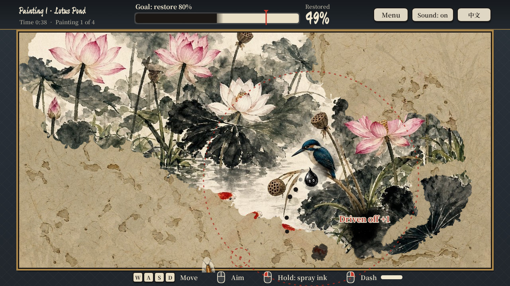

# Ink Bloom · 墨染

Bookworms have eaten four paintings blank. Play as a drop of ink. Walk, spray and dash to uncover lotus leaves, tiny boats and birds hiding under the paper.

[Play in English](http://47.237.175.21:8080/ink-bloom/?lang=en) · [玩中文版](http://47.237.175.21:8080/ink-bloom/?lang=zh)

## Play offline

Download this repository using **Code → Download ZIP**. Extract the folder, open `src/index.html` in a desktop browser, and click **Start**. The language switch is at the top right.

| Input | Action |
| --- | --- |
| W, A, S, D | Move and leave a trail of ink |
| Mouse | Aim |
| Hold the left button | Spray ink |
| Right-click | Dash toward the pointer |

Restore 80% of each of the first three scrolls. Once 60% is visible, spray inside the green ring or dash through its centre to reveal a broad patch. Choose a brush technique between scrolls. On the fourth scroll, dodge the Bookworm King and ink its tail.

**中文玩法**　解压后用电脑浏览器打开 `src/index.html`，点击「开始」。WASD 移动，鼠标瞄准，按住左键泼墨，右键冲刺。前三卷染回八成即可过关，最后一卷需要绕到蠹王身后，向尾巴泼墨。

## Project files

- `src/` contains the complete playable game, including both languages, the four paintings and the sound.
- `art/` contains the original generated artwork and the font sources with their license notices.
- `tools/` contains the scripts to prepare assets, check the game and build a shareable copy.

With Node.js installed, run `node tools/check.mjs` to check the game. Run `node tools/build.mjs` to create a standalone HTML file and a browser build ZIP in `dist/`.

The artwork, sound and font credits are in [CREDITS.md](CREDITS.md).
